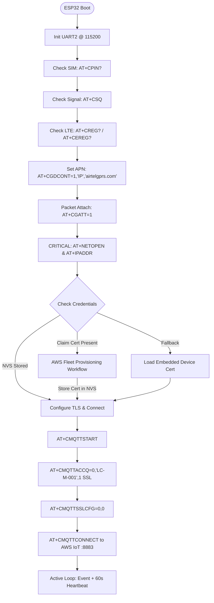

# Level Crossing (LC Gate) Master Firmware - ESP32 + SIMCom A7672S

Firmware for Level Crossing (LC Gate) Master node connecting to **AWS IoT Core** over 4G LTE Cat 1 via **SIMCom A7672S-LASC**. Supports both **Fleet Provisioning by Claim** and **Direct Certificate Fallback**.

---

## 1. Root Cause Analysis of Previous Failure

In your serial monitor log, the sequence failed at:
```text
AT> AT+CSSLCFG="cacert",0,"rootca.pem"
OK
AT> AT+CSSLCFG="clientcert",0,"claimcert.pem"
OK
AT> AT+CSSLCFG="clientkey",0,"claimkey.pem"
OK
AT> AT+CMQTTSTOP
ERROR
AT> AT+CMQTTSTART
ERROR
```

### Why `AT+CMQTTSTART` Returned `ERROR`:
1. **Missing `AT+NETOPEN` (IP Data Bearer)**:
   - On SIMCom A7672S / A76XX modules, `AT+CGATT=1` only attaches to the cellular tower's packet service.
   - It **does not** open the IP socket stack!
   - SIMCom requires **`AT+NETOPEN`** to activate the external PDP context and obtain an IP address before starting any IP services (`AT+CMQTTSTART`, `AT+CIPOPEN`, `AT+HTTPINIT`).
   - Calling `AT+CMQTTSTART` before `AT+NETOPEN` results in an immediate **`ERROR`**.

2. **Missing Server Name Indication (SNI)**:
   - AWS IoT Core ATS endpoints (`*-ats.iot.ap-south-1.amazonaws.com`) run multi-tenant TLS servers.
   - Without `AT+CSSLCFG="enableSNI",0,1`, the modem sends a TLS ClientHello without SNI, causing AWS IoT to reject the TLS handshake.

3. **MQTT Service & Client State Management**:
   - `AT+CMQTTSTOP` fails if MQTT was not already running.
   - If the ESP32 resets while the modem remains powered, client index 0 remains occupied until released with `AT+CMQTTREL=0`.

---

## 2. Hardware Connections & Pinout

| ESP32 Pin | A7672S / Sensor Pin | Description |
| :--- | :--- | :--- |
| **GPIO 18** | **Modem TXD** | ESP32 UART2 RX (Receives AT responses) |
| **GPIO 17** | **Modem RXD** | ESP32 UART2 TX (Transmits AT commands) |
| **GND** | **Modem GND** | **Mandatory Common Ground** |
| **GPIO 23** | **Limit Switch** | Digital Input (HIGH = CLOSED). External 10kΩ pulldown resistor to GND. |
| **GPIO 22** | **Hall Sensor** | Digital Input (LOW = CLOSED). Configured with internal `INPUT_PULLUP`. |

### Critical Hardware Warnings:
1. **Power Supply**:
   - The SIMCom A7672S consumes **up to 2A peak current** during LTE transmissions and TLS handshakes.
   - **DO NOT** power the SIMCom module from the ESP32's 3.3V or 5V pin, or directly from a low-current USB port (500mA). Voltage dips will brown out the modem, causing silent restarts or dropped TCP packets.
   - Use an **independent 5V 2A–3A DC power source** (or robust Li-Po / DC-DC stepdown) connected to the modem board's DC input, with **common ground (GND)** tied to the ESP32.
2. **Antenna**:
   - Ensure the 4G LTE whip/flexible antenna is firmly connected to the **MAIN** antenna connector on the A7672S (not AUX or GNSS).

---

## 3. Firmware Architecture & Cloud Flow



---

## 4. How to Test on AWS IoT Core

1. Open the **AWS IoT Core Console**.
2. Navigate to **MQTT test client**.
3. Under **Subscribe to a topic**, enter:
   ```text
   lc-gate/#
   ```
4. Click **Subscribe**.
5. Once the ESP32 boots and connects, you will see telemetry published:
   ```json
   {
     "MasterDeviceId": "LC-M-001",
     "DeviceType": "LC_GATE_MASTER",
     "Status": "CLOSED",
     "SensorType": "InitialState",
     "LimitSwitchClosed": true,
     "HallClosed": false,
     "TimeStampMs": 14502
   }
   ```
6. A periodic heartbeat is emitted every 60 seconds, and instant event updates are emitted whenever the limit switch or Hall effect sensor triggers.
